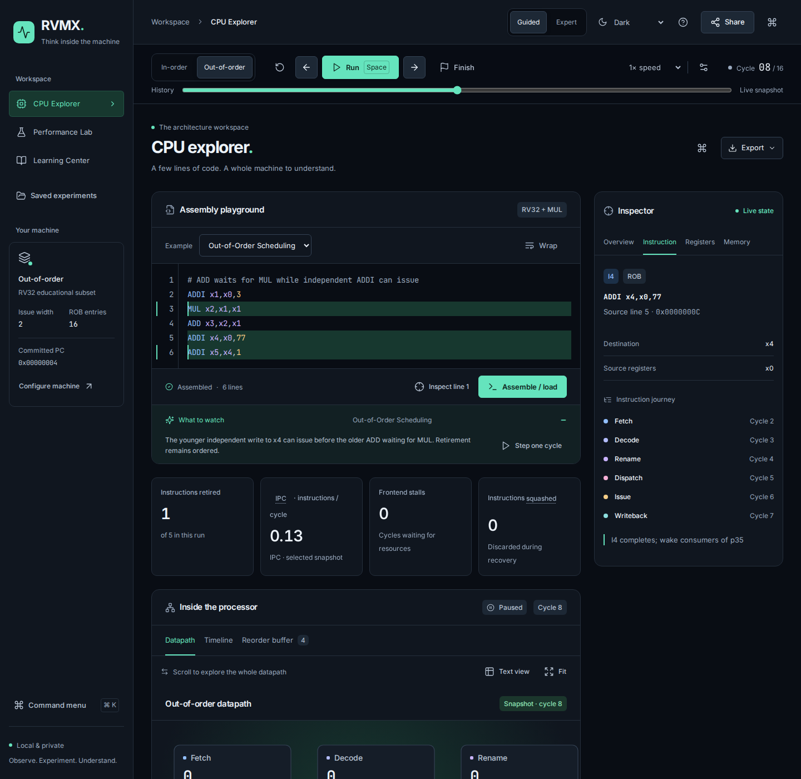
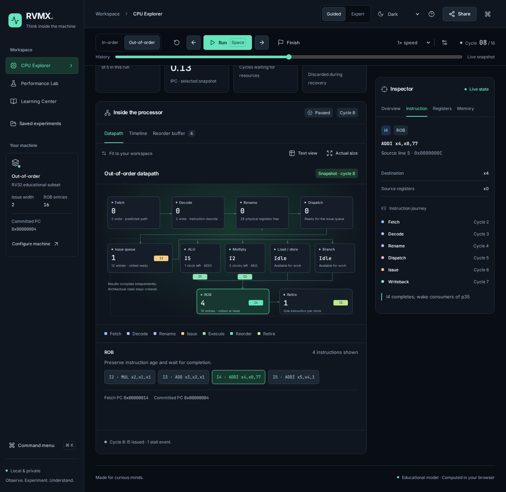
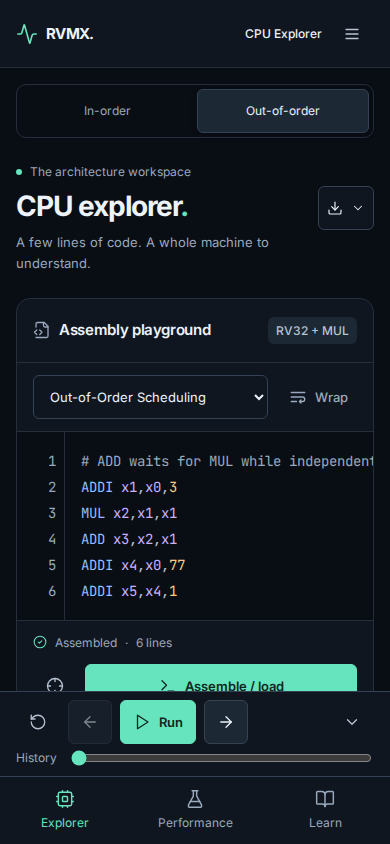

# RVMX · Think inside the machine

A few lines of code. A whole machine to understand.

RVMX is a browser-based RISC-V architecture lab for students and engineers. Write assembly, follow real pipeline snapshots, inspect dependencies, and compare independently executed in-order and out-of-order CPUs.



## UI v2

- **A focused workspace:** fixed playback controls, visualization tabs, a synchronized inspector, and a configuration drawer with presets and a change preview.
- **Guided or Expert:** explanations and a five-step tour for learning; denser tools, split views, and trace analysis for deeper inspection.
- **Work that stays with you:** bookmarkable routes, saved drafts and assembled source, local experiments/presets, and compressed share links that open paused.
- **Learn by trying:** 13 short lessons with real-snapshot mini-processors, runnable examples, quizzes, saved progress, a searchable glossary, and assembly reference.
- **Analysis tools:** command search, keyboard shortcuts, pinned-run comparisons, CSV/JSON data, standalone SVG/PNG images, and copied run summaries.
- **Three themes:** Dark, Light, and High contrast, with bundled Inter and JetBrains Mono fonts.
- **Mobile support:** labeled bottom navigation, 44px execution controls, a More sheet, and an inspector sheet with drag/keyboard resizing.

The application runs locally in the browser. No backend, account, or paid API is required. Share links include the program and CPU configuration; saved experiments and progress otherwise stay on the device.

## Start locally

Use Node.js **22.12+** and npm:

```bash
npm ci
npm run dev
```

Open the local URL printed by Vite. Choose a Guided or Expert experience, select an example, and use **Assemble / load**. Step one cycle or press **Run**. Edits remain a draft until assembled; the previous program stays loaded while the draft has errors.

**Configure CPU** opens the drawer. Small, Typical, and Wide presets are starting points. **Apply & restart** applies reviewed changes and resets both CPUs.

## Keep the original version

The original application remains on **`main`** at `d86a0d6`. The redesign is on **`redesign/ui-v2`**, with a tested commit for each implementation phase.

```bash
# Original version
git switch main
npm ci
npm run dev

# New UI
git switch redesign/ui-v2
npm ci
npm run dev
```

Stop a running development server before switching branches. Use `npm run dev` after switching, or rebuild before using `npm run preview`, so a previous generated `dist/` is not mistaken for the selected branch.

## Workspace

| Route | Purpose |
| --- | --- |
| `/#/explorer` | Source editor, datapath, timeline, reorder buffer, rename, scheduler, memory queue, charts, and trace |
| `/#/performance` | Independent CPU comparison, interpreter verification, pinned runs, and execution metrics |
| `/#/learn` | Searchable lesson list and assembly reference |
| `/#/learn/:lessonId` | Concept, interactive mini-processor, runnable example, and quiz |
| `/#/learn/glossary` | Searchable technical definitions |

Select an instruction in the editor gutter, diagram, buffer, trace, or timeline to open its inspector. A full-size **Inspect current source line** action is also available beside Assemble. Timeline cells select their clock as well as their instruction. The inspector distinguishes committed register/memory state from speculative rename/queue state.



## Keyboard shortcuts

| Key | Action |
| --- | --- |
| Space | Run / pause |
| → / ← | Next / previous cycle |
| R | Reset |
| F | Run to completion |
| [ / ] | Previous / next visualization tab |
| Ctrl / Command + K | Search commands, examples, views, and settings |
| ? | Help and shortcuts |
| Esc | Close a dialog, popover, or tour |

Shortcuts respect typing fields and native control behavior. Tab groups and mode controls use arrow keys; modal dialogs contain focus and restore it when closed. Mobile users can open commands and saved experiments from the workspace menu.

## Analysis and exports

**Export** offers run/trace JSON, timeline CSV/JSON, metrics CSV, an image of the visible diagram/chart, and a copied run summary. Charts also have individual SVG/PNG exports and a **View as table** toggle.

Save named experiments from the sidebar or mobile menu, and import/export them as JSON. Save named CPU presets in the configuration drawer. In Performance Lab, pin up to five runs and compare preserved configurations/results with cycle, IPC, and stall deltas. Runs that fault or reach a safety limit are labeled accordingly.

## CPU model

The simulation logic is unchanged by the UI redesign:

- Five-stage in-order pipeline with forwarding, load-use interlocks, configurable blocking latencies, redirects, and retirement.
- Independent out-of-order CPU with physical registers, speculative/committed maps, a free list, oldest-ready issue, four execution units, a reorder buffer, and ordered retirement.
- Static, 1-bit, and 2-bit branch prediction; actual wrong-path execution, younger squash, mapping recovery, and precise fatal alignment faults.
- Both models are checked against an independent architectural interpreter.

Supported instructions: **ADD, SUB, AND, OR, XOR, ADDI, MUL, LW, SW, BEQ, BNE, JAL, NOP**. Use x0–x31, labels, signed decimal/hex immediates, and aligned word addresses. Stores become architectural at retirement. Memory is sparse and zero initialized; addresses wrap to 32 bits. Misaligned loads/stores fault, including loads into x0.

This is a simplified RV32 teaching model. It does not implement the full ISA, caches, address speculation, store forwarding, trap handlers, CSRs, interrupts, atomics, or compressed instructions. Runs are bounded to **128 static instructions, 160 retirements, or 2,000 clocks**. Timing describes the simulated model, rather than physical processor performance.

Only execution latencies apply to in-order. Out-of-order capacities and widths are configurable, but dependencies and execution-unit conflicts still limit throughput. Retirement is one instruction per clock. See the model documentation for precise stall and prediction definitions.

## Verification

```bash
npm test                  # 91 unit tests; includes all 79 original CPU tests
npm run check:ui          # tokens, text size, removed legacy selectors
npm run build             # strict TypeScript + production build
npm run check:bundle      # initial JavaScript gzip budget
npx playwright install chromium
npm run test:browser      # workflows, axe, keyboard, responsive, visual checks
npm run test:a11y         # accessibility subset
npm run test:visual       # reviewed screenshot baselines
```

The suite uses the matching Chromium revision installed by Playwright, including in CI. Set `CHROME_BIN` or `PLAYWRIGHT_CHROMIUM_EXECUTABLE_PATH` to use another compatible executable for workflow/accessibility checks; visual baselines should use the matching revision because browser font rendering can differ. Review baseline changes before running `npm run test:visual -- --update-snapshots`.

The measured desktop production build scored **100 Performance / 100 Accessibility / 100 Best Practices** in Lighthouse. Initial JavaScript is **about 96 KB gzip**. See [quality results and methodology](docs/QUALITY_REPORT.md).

## Accessibility

The UI targets WCAG 2.2 AA with readable type, contrast-checked themes, named controls, visible focus, a skip link, navigation landmarks, accessible tab/radio groups, modal focus handling, and reduced motion. Charts expose equivalent data tables and diagrams have a text view. Stage/status names accompany color, and live cycle announcements are throttled during playback.

Automated axe scans cover all themes and main views plus active tools and dialogs. Keyboard, focus return, sheet gestures, and 200% equivalent layout have been checked in Chrome. The validation scope is recorded in [QUALITY_REPORT.md](docs/QUALITY_REPORT.md).



## Source and hosting

```text
src/app/         Shell, routes, navigation, execution bar, configuration drawer
src/features/    Explorer, performance, learning, onboarding, commands, experiments
src/state/       Workspace, UI, settings, and experiment stores
src/components/  Reusable controls, editor, processor views, tables, charts
src/styles/      Tokens, themes, base/layout rules, component styles
src/cpu/         Independent CPU engines and architectural verification
src/engine/      Assembler, interpreter/adapters, original example programs
tests/           Unit tests, Playwright tests, visual baselines
```

Vite produces static files in `dist/`. `vercel.json` uses `npm run build` and the `dist` output, and hash routes work on static hosts. No environment variables are required. This branch has been implemented and verified locally; it has not been published.

GitHub Actions runs installation, unit tests, token checks, build/bundle checks, Playwright, axe, and visual regression tests. Branding assets are generated from tokens with `npm run brand`.

## Documentation

- [Design system](docs/design-system.md) and [component contracts](docs/components.md)
- [Redesign brief](docs/RVMX_REDESIGN_PLAN.md), [phase record](docs/REDESIGN_PROGRESS.md), and [baseline audit](docs/UI_UX_AUDIT.md)
- [Architecture and snapshot APIs](docs/ARCHITECTURE.md)
- [In-order rules](docs/IN_ORDER_CPU.md) and [out-of-order rules](docs/OUT_OF_ORDER_CPU.md)
- [Verification](docs/VERIFICATION.md) and [performance metric definitions](docs/PERFORMANCE_METRICS.md)
- [CPU verification example](examples/cpu-verification.s)
- [Changelog](CHANGELOG.md)

MIT license; see [LICENSE](LICENSE). Bundled font notices are included in `public/font-licenses.txt`. Public reference: [RISC-V RV32I specification](https://docs.riscv.org/reference/isa/unpriv/rv32.html).
