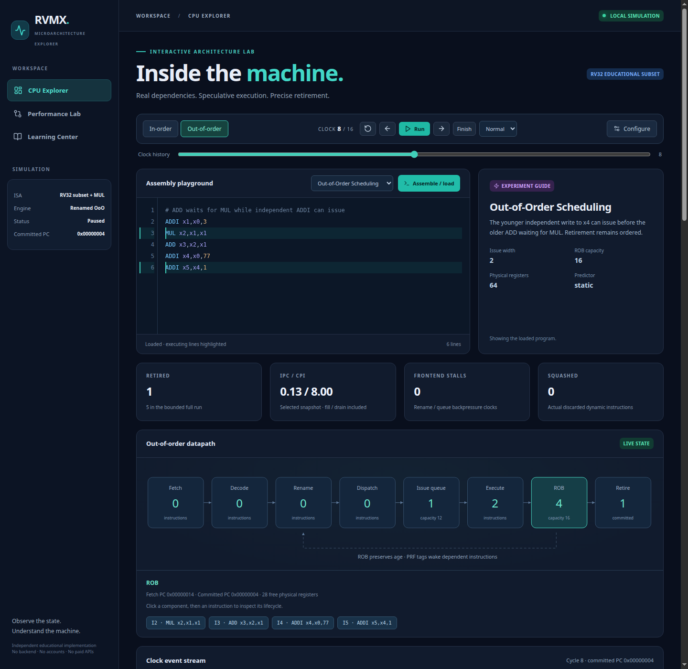
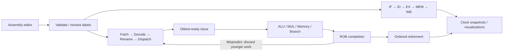
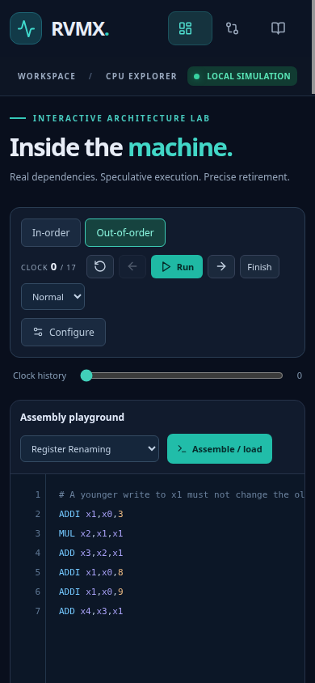

# RVMX — RISC-V Microarchitecture Explorer

An interactive, entirely client-side CPU architecture lab. Write RV32 assembly,
follow real pipeline state, inspect physical-register dependencies, and compare
independent in-order and out-of-order execution against an architectural interpreter.



## Features

- Five-stage in-order CPU with explicit latches, forwarding, load-use bubbles,
  configurable blocking execution latency, branch redirects and retirement.
- Independent OoO CPU with physical registers, speculative RAT, committed map,
  free list, bounded issue queue, oldest-ready selection, four execution units,
  ROB, in-order retirement and conservative load/store ordering.
- Static, one-bit and two-bit branch prediction, actual wrong-path execution,
  younger squash, mapping recovery and precise fatal alignment faults.
- Clickable SVG architecture diagrams connected to live snapshots.
- ROB/head eligibility, source readiness/tags, RAT/physical register and LSQ viewers.
- Syntax-highlighted assembly editor, labels, line numbers, validation and
  executing-line highlighting; eleven original, explained examples.
- Run/pause, reset, previous/next clock, finish, animation speed, history slider,
  instruction lifecycle inspection including squashes and stall reasons.
- Committed register/memory inspectors with changed-value highlights.
- Event-derived IPC/CPI, stalls, predictor accuracy, squashes, recovery clocks,
  queue occupancy and unit utilization charts.
- Side-by-side independent timelines, completion/retirement order and automatic
  register/memory/PC/fault verification against the sequential interpreter.
- Validated CPU configuration; apply resets both engines cleanly.
- Responsive dark dashboard and architecture learning center.

No backend, account, paid API or private repository dependency is required.
This is a simplified **RV32 teaching model**, not full ISA compliance, RTL cycle
accuracy or a predictor of physical CPU performance.

## Architecture



Architectural state is distinct from speculative pipeline/rename state. Both
engines calculate their own values and branches. The interpreter is used only
for verification. Stores become visible at retirement; squashed operations
cannot change architectural registers or memory.

## Supported instruction subset

| Instructions | Behavior |
| --- | --- |
| ADD, SUB, AND, OR, XOR | 32-bit register operations with wraparound |
| ADDI | Signed 12-bit immediate |
| MUL | Low 32-bit product, educational RV32M subset |
| LW, SW | Aligned 32-bit words, signed 12-bit offset |
| BEQ, BNE | Conditional control flow to a label |
| JAL | Label jump with link register |
| NOP | No effect; still retires |

Use x0–x31, decimal or signed hexadecimal immediates, labels such as `loop:`,
and offsets such as `0(x1)`. The editor decodes assembly, not machine words.
Memory is sparse, zero-initialized word storage at unsigned byte addresses
wrapping modulo 2^32. Misaligned accesses cause a precise fatal simulator fault,
including loads into x0. No byte accesses or endianness behavior is exposed.

Unsupported: other RV32I/M instructions, RV64, compressed/floating-point/vector
instructions, atomics, CSRs, interrupts, privileged trap handlers, virtual memory,
MMIO, caches and self-modifying code. Runs are bounded to 128 static instructions,
160 retirements or 2,000 clocks. A safety stop is never labeled verified.

## Ubuntu installation and VS Code

Install Git, Node.js **22.12+** and npm using your preferred Ubuntu setup.
Clone your public repository and open it in VS Code (`code .`). In the integrated
terminal:

```bash
npm install
npm run dev
```

Open the local URL printed by Vite. Select an example and click **Assemble / load**.
Step clocks or click **Run**. Switch CPU mode to inspect the same program.
Open **Configure** to apply parameters and reset both histories. **Performance
Lab** verifies the complete runs and compares independently modeled timing.

```bash
npm test              # deterministic unit and differential tests
npm run test:watch    # watch tests during development
npm run build         # strict TypeScript + static production build
npm run preview       # inspect the production build
npm run test:browser  # optional headless Chrome smoke checks + screenshots
```

Browser checks require Google Chrome on PATH, or `CHROME_BIN` pointing to a
compatible Chromium executable. They use an isolated temporary profile and
localhost ports 5175/9224; regular tests/build need no browser installation.

## Configuration and interpretation

Fetch/decode/issue widths (1–4), ROB size (2–64), physical registers (33–128),
issue capacity (1–64), ALU latency (1–8), MUL latency (1–16), and predictor mode
are configurable. Only execution latencies apply to in-order. OoO has one
nonpipelined unit of each kind and fixed one-instruction retirement width.
A wide configuration can still be limited by dependencies, unit conflicts,
physical registers or memory ordering; OoO is not guaranteed to be faster.

Loads/stores wait for all older memory operations to retire. There is no memory
speculation or store forwarding. Recovery reconstructs mappings functionally;
recovery clocks count frontend suppression, not a measured counterfactual cost.
Predictor training/statistics include speculative resolutions. Stall definitions
and stage-based utilization differ between the two models and are labeled.

## Verification

[CPU verification assembly](examples/cpu-verification.s) checks arithmetic, memory,
load-use, branches, jumps and x0. Every branch/jump target must have a matching
label, even if the branch is expected not to be taken.

**79 automated tests** cover directed behavior, state invariants and seeded
programs. Differential checks compare all registers, memory, retired PC sequence,
final PC and fatal faults. Real Chrome smoke checks exercise every example,
both diagrams, stepping/replay, configuration, faults, verified comparison and
responsive layout. See [verification details](docs/VERIFICATION.md).

## Static hosting: GitHub and Vercel

After tests/build pass, inspect the diff, commit the independent public files,
and push your existing GitHub branch. Do not overwrite remote history.

Import the GitHub repository into Vercel and select **Vite**, build command
`npm run build`, output directory `dist`. No environment variables are required.
The existing `vercel.json` supports static SPA routing. Eligible personal projects
can use Vercel Hobby subject to the provider's current plan terms. This repository
has been built locally; no new public deployment is claimed.

GitHub Actions runs install, tests and build. For GitHub Pages hosting, additionally
configure Vite's base path to the repository name and add a Pages artifact/deploy
workflow; the current base `/` targets root hosting such as Vercel.

## Documentation and source

- [Architecture and snapshot APIs](docs/ARCHITECTURE.md)
- [Upgrade plan and milestone record](docs/ARCHITECTURE_UPGRADE_PLAN.md)
- [In-order rules](docs/IN_ORDER_CPU.md)
- [OoO ordering, predictors and recovery](docs/OUT_OF_ORDER_CPU.md)
- [Verification](docs/VERIFICATION.md)
- [Performance metric definitions](docs/PERFORMANCE_METRICS.md)

CPU engines are in `src/cpu/`; parser/interpreter/adapters in `src/engine/`;
React components in `src/components/`; tests in `tests/`. Browser runtime contains
no Node APIs. Optional browser-test scripts use Node outside the application.

## Roadmap and educational purpose

Future extensions: binary decoding, broader ISA support, byte memory, caches,
verified store forwarding, pipelined units, branch checkpoints, configurable
retirement width and trace export. Each requires additional verification before
being advertised as accurate.

Built for engineering students exploring execution, hazards, renaming,
speculation and precise retirement. All public implementation and examples are
independently written. No private source or artifacts are included.
Public ISA reference: [RISC-V RV32I specification](https://docs.riscv.org/reference/isa/unpriv/rv32.html).
MIT license; see LICENSE.

<details><summary>Mobile screenshot</summary>



</details>
