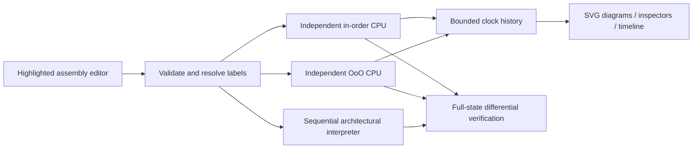

# Public architecture

## Layout

- `src/engine/assembler.ts`: assembly-level decoding, operand validation, labels.
- `src/engine/simulator.ts`: independent sequential interpreter and compatibility
  adapters for both engines. Simulation does not consume interpreter results.
- `src/cpu/inorder/engine.ts`: pure five-stage pipeline transitions and latches.
- `src/cpu/ooo/engine.ts`: config validation, RAT/PRF/free list, queues, execution,
  ROB, conservative LSQ, branch prediction and precise recovery.
- `src/cpu/verification/compare.ts`: independently compare both final states
  against the interpreter, including memory, faults and retirement sequence.
- `src/components/editor/`: accessible text input with synchronized highlighting.
- `src/components/architecture/`: SVG diagrams, ROB, scheduling, renaming, LSQ,
  configuration, lifecycle and performance components.
- `src/engine/programs.ts`: eleven original examples and expected behavior.
- `scripts/browser-smoke.mjs`: optional local Chrome smoke checks/screenshots.
- `tests/`: directed, seeded and full-state differential verification.

## Snapshot APIs

`initialState`, `step` and `runPipeline` expose the in-order model. `initialOoo`,
`stepOoo`, `runOoo` expose OoO state. React is not imported by either engine.
A step copies mutable arrays, maps and entries before updating them; callers
must treat returned snapshots as read-only. Old histories can be replayed
without reapplying stores. Dynamic instruction IDs are unique per fetch and
may contain gaps in retirement after squashes.

Committed state is separate from frontend and speculative state. Configurations
must remain unchanged within a run. Applying configuration in the UI creates
both histories afresh and resets the clock, selection and running status.
Only ALU/MUL latency changes affect in-order; width/capacity/predictor settings
apply to OoO. A nonpipelined in-order execution stage and four separate OoO units
are deliberately different microarchitectures.

## Scope

An assembly-level RV32I subset plus low-word MUL, not machine instruction binary
decoding, full RV32I/M, RV64, RTL cycle accuracy, or silicon performance modeling.
Memory addresses wrap to unsigned 32-bit values. Word storage exposes no byte
endianness. Static instructions begin at PC 0 in a separate instruction array;
stores cannot modify instruction memory. All implementation and examples are
independently written. No private source, configuration or traces are used.

## Browser operation

The application is a static Vite/React client with no backend or paid APIs.
Charts load in a separate dynamic chunk. Fonts fall back to local system faces;
no network font dependency is required. Runs precompute at most 2,000 clocks
or 160 retirements; Previous and the history slider select stored snapshots.
These are pedagogical resource bounds, not architectural exceptions.
